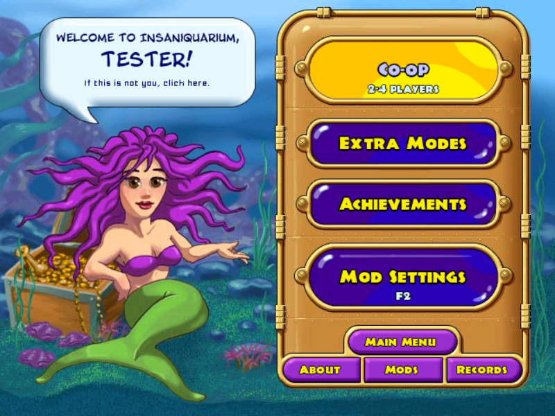

# Insaniquarium - Remastered Mod

<!-- badges: shown on GitHub only (tools/package.sh leaves this block out of README.txt) -->

-0078D6)

**[Download](https://github.com/undecuple/insaniquarium-remastered/releases/latest)** · **[Install](docs/INSTALL.md)** · **[Status](#status)** ·
**[Roadmap](docs/ROADMAP.md)** · **[Developing](DEVELOPING.md)** · **[Contributing](CONTRIBUTING.md)**
<!-- /badges -->

**Mods for the original *Insaniquarium! Deluxe* on Steam:** online co-op for 2-4 players, extra modes, achievements,
mutators, a large sharp window and more, in the game you already own. Drop a few files into the game folder and play
as usual. It never changes the game's own files, and removing it is deleting what you added.

Unofficial fan project, not affiliated with PopCap Games or EA. No game files are included: you need your own copy.

## Status
| | |
|---|---|
| Steam release on Linux / Steam Deck (Proton) | works: tested with Proton-GE and with the Steam client's own Proton |
| Windows 10/11 | built for it, not yet tested on a real Windows PC: reports are welcome |
| Online co-op (the public server) | works, 2-4 players (tested with four games at once) |
| Co-op over Steam | works; not yet tested between two Steam accounts |
| Game updates | if Steam updates the game, the mod stays off (the game runs as normal) until the mod is updated |

What's done and planned: [docs/ROADMAP.md](docs/ROADMAP.md).

## Screenshots

**The Remastered page** on the main menu: every mod screen. More in [docs/screenshots](docs/screenshots/):
- [Online co-op](docs/screenshots/coop-online.png): Public Match, Private Match, or join from the list
- [The lobby](docs/screenshots/coop-lobby.png): avatars, roles, versus, split money
- [Four players](docs/screenshots/coop-ingame.png) in one tank, each with a named pointer
- [Extra Modes](docs/screenshots/extra-modes.png): Daily Challenge, Boss Rush, Endless, Sandbox, Play as Alien
- [Play as Alien](docs/screenshots/play-as-alien.png): steer the alien against a computer keeper
- [15 mutators](docs/screenshots/mutators.png) that change the rules
- [31 achievements](docs/screenshots/achievements.png) with shell rewards
- [Every key](docs/screenshots/keys-page.png) can be changed
- [Records](docs/screenshots/records.png): your bests and Hall of Fame tables

## Installing
You need ***Insaniquarium! Deluxe* from Steam** ([store page](https://store.steampowered.com/app/3320/)), installed
and run once, on Windows 10/11 or Linux / Steam Deck (Proton).

1. **[Download](https://github.com/undecuple/insaniquarium-remastered/releases/latest)** the zip and unpack it.
2. **Windows:** copy `ddraw.dll`, `install-steam.bat` and the `mods` folder into the game folder (Steam → right-click
   the game → **Manage → Browse local files**) and double-click `install-steam.bat`.
   **Linux / Steam Deck:** run `bash install-steam.sh` in the unpacked folder.
3. Play from Steam as usual. The title screen says "Insaniquarium - Remastered Mod is on".

Step by step, updating and uninstalling: **[docs/INSTALL.md](docs/INSTALL.md)** (`INSTALL.txt` in the download).
The mod checks the game's code when it starts: with any other version of the game it stays off and the game runs as
normal ([docs/GAME-UPDATES.md](docs/GAME-UPDATES.md)).

## Features
Open everything from the **Remastered** button on the main menu (bottom left), or with the keys below.

| Mod | What it does |
|---|---|
| **coop** | Co-op for 2-4 players: online with no setup, over Steam, or by address (see below) |
| **extramodes** | **Daily Challenge** (the same tank and mutators for everyone that day), **Boss Rush**, **Endless**, and **Records** |
| **alienplay** | **Play as Alien:** 20 stages where you steer the alien while a computer keeper shoots back |
| **sandbox** | The game's hidden sandbox as a mode: place fish, aliens and pets, backdrops, three save slots |
| **mutators** | 15 optional rule changes (hungry fish, double trouble, glass cannon, tiny wallet, tank events...) |
| **achievements** | 31 achievements with shell rewards, a banner when one unlocks, progress saved per profile |
| **hovercoins** | Coins are collected when the pointer passes over them |
| **autosave** | Saves the level and your profile every 2 minutes and whenever the game pauses |
| **continues** | When all your fish die, spend shells (500, then 1,000...) for two guppies and keep going |
| **accessibility** | A red **!** over hungry fish, and each coin's value under it (off at first: the Gameplay tab) |
| **timecontrol** | Pause, or play at 0.75x or 2x, in any tank |
| **screenshot**, **fps** | A screenshot key (PNG in the game folder's `screenshots` folder) and a frame counter |
| **screensaver** | Your Virtual Tank as the game's own screensaver, from the main menu |
| **content** | Content packs: replace the game's images, sounds and music, or change its levels ([DEVELOPING.md](DEVELOPING.md#content-packs)) |
| **settings** | The settings page, the Remastered page and the Mods page (switch mods off or on) |

**Co-op.** The **Online** tab is the default: host a **Public Match** (listed for anyone) or a **Private Match**
(friends join with its room code), or join from the list, through the mod's public server: no ports to open, nothing
to set up. The list shows each match's mod version, and greys the ones you can't join. The other tabs: **Steam** (the same through Steam lobbies), **Direct** (by address; the host opens TCP port
27615) and **Server** (your own server: [docs/SERVER.md](docs/SERVER.md)). Everyone plays the host's profile (your own
saves are never touched; shells you earn come home with you), with roles, chat, pings (middle click), avatars, tougher
tanks for more players, split money, joining a game in progress, and **Versus** (one player steers the aliens). The
host is in charge of pausing, speed and menus. Everyone needs the same mods. Steam co-op needs Valve's
`steam_api.dll`, which the mod usually finds in another Steam game by itself ([docs/STEAM.md](docs/STEAM.md)).

**Window.** A **Large** window by default (as large as the screen allows, resizable, sharp scaling, the game's own
cursor at the same size), the game's own **640x480**, or **Borderless** (fills the screen). The game's Fullscreen box
and Alt+Enter switch to Borderless and back. Tiling desktops (niri, sway...) size the window themselves.

**Safety nets.** Hold **Shift** while the game starts to play without mods. A mod that crashes is switched off with a
message and the game keeps going. Your profiles are copied to `userdata-before-remastered-mod` before the first run.

## Keys
Change any of them on the settings page's **Keys** tab (click a key, press the new one; right-click for the default).

| Key | Does | Where |
|---|---|---|
| **F2** | the settings page | anywhere but co-op |
| **F7** | the co-op screen | main menu |
| **F4** | the list of achievements | anywhere but co-op |
| **F5** / **F6** / **F8** | pause / 0.75x / 2x (again: back to normal) | in a tank; in co-op only the host |
| **F3** / **F12** | frame counter / screenshot | anywhere |
| **F11** | the screensaver | main menu |
| **F9** | the gadgets (Gadgets mutator) | in a tank |
| **Enter** | a chat line (Enter sends, Esc drops) | in a co-op game or lobby |
| **Space** | the game's own pause dialog | in a tank |

## Settings
Everything is on the settings page (**F2**); changes apply at once. The settings are kept in
`mods/remastered-mod.ini`, which you can also edit: **[docs/SETTINGS.md](docs/SETTINGS.md)**.

## Troubleshooting
Everything Insaniquarium - Remastered Mod does is written to **`mods/remastered-mod.log`** in the game folder. Look there first.

| Problem | What to do |
|---|---|
| No "Remastered Mod is on" message on the title screen, no log file | The loader isn't being used. Windows: did `install-steam.bat` say *installed* (it copies `ddraw.dll` to `C:\ProgramData\PopCap Games\Insaniquarium`)? Linux: run `install-steam.sh` again, or set the launch option `WINEDLLOVERRIDES="ddraw=n,b" %command%`. |
| Log says "not the Insaniquarium Deluxe 1.1 game these mods are for" | A different version of the game: Insaniquarium - Remastered Mod stays off on purpose. |
| Log says "safe mode" | Shift was held while the game started, or `[core] enabled=0`. |
| A message says a mod "crashed and was switched off" | That mod is off until the next start; the log names it and where it failed. Please report it. |
| The game doesn't start at all | Remove the loader (Windows: `install-steam.bat uninstall`; Linux: `install-steam.sh --uninstall`) and tell us what the log said (open an issue). |
| On a tiling desktop (niri, sway, Hyprland...) the window is another size, with black bars | The desktop sizes windows itself; the mod leaves its choice alone and scales the game into whatever size it gets. For the whole screen pick **Borderless** (or your desktop's own fullscreen for the window). |
| The window isn't the size you chose | The game is a large window by default: pick **640x480** or **Borderless** in the Display tab (or `[display] window=normal`, `borderless`); it changes at once. The log says "native window: ..." for Large and Borderless, "display: A -> B" for each change, and "display: switching the game to ..." when the game came up in the other screen mode. |
| Speed keys do nothing | They only work inside a tank, and the game window must have focus. In co-op only the host changes the speed (for everyone); a guest gets "Only the host controls the speed in co-op". Check the keys in `remastered-mod.ini`. |
| The screensaver closes straight away | Moving the mouse or pressing a key ends it, as any screensaver; keep still for a second after starting it. The log says how it ended (`screensaver: ended after ...`). |
| The Windows arrow shows instead of the game's cursor | Only in the **Large** or **Borderless** window, if the game's cursor pictures couldn't be read: the log says "couldn't make the game's cursors". |
| Co-op says "Out of sync" | The players' games no longer match; the host sends everyone its game and you carry on from there ("Back in step with the host"), a few moments later than you were. If it keeps happening, report it with every player's `remastered-mod.log` (it records what differed): usually different mod versions. |
| Co-op: "The game is full" | The game has four players already (joining a game in progress is fine while there is room). |

## Is it safe?
- It doesn't modify the game's files, and keeps a copy of your saves before its first run.
- Mods are programs that run inside the game. Only install mods from people you trust; Insaniquarium - Remastered Mod only loads DLLs from
  its own `mods` folder.
- Insaniquarium - Remastered Mod only uses the network for co-op, and only once you host or join a game (direct
  connections to the address you typed, Steam's lobbies and relay, or the co-op server: the mod's public one unless you
  set your own; it sees an anonymous id made by your game, the room codes and the game's messages). Nothing else goes online:
  no updates, no statistics. Your profiles, achievements and records never leave your computer. A co-op server keeps
  only that anonymous account (servers may remove old ones; the game makes a new one by itself) and, while you host a
  public match, its listing. A server may log co-op chat lines for moderation, and like any web server it sees your IP
  address.
- Some antivirus programs distrust DLLs that change how a game behaves; that's a false alarm, but you can build it
  from source yourself (see DEVELOPING.md), and every release is built by GitHub Actions from the tagged commit
  (reproducible: the same commit gives the same zip, checksums on the release page).

## Documentation
| | |
|---|---|
| [docs/INSTALL.md](docs/INSTALL.md) | installing, updating and uninstalling (Windows, Linux, Steam Deck) |
| [docs/SETTINGS.md](docs/SETTINGS.md) | every setting in `remastered-mod.ini` |
| [docs/SERVER.md](docs/SERVER.md) | hosting your own co-op server (Docker: Nakama + Postgres, HTTPS) |
| [docs/STEAM.md](docs/STEAM.md) | how the Steam release runs the game, and co-op over Steam |
| [DEVELOPING.md](DEVELOPING.md) | building from source and **making your own mods** (the API, hooks, testing, co-op rules) |
| [docs/MOD-MANAGER.md](docs/MOD-MANAGER.md) | how a mod shows up on the Mods page and the Remastered page |
| [docs/GAME-UPDATES.md](docs/GAME-UPDATES.md) | which game functions each mod uses, and what to do if the game is updated |
| [docs/ROADMAP.md](docs/ROADMAP.md) | what's done and what's planned |
| [NOTICE.md](NOTICE.md) | third-party components, credits, and how to reuse or cite this work |

## Building from source
On Linux (or WSL) with the 32-bit MinGW cross compiler: `tools/fetch-deps.sh` (MinHook), then `./build.sh` (files in
`build/dist/`), and `tools/package.sh` for the release zip. Details and the Windows/Debian packages: DEVELOPING.md.

## Reporting bugs
Open an issue (https://github.com/undecuple/insaniquarium-remastered/issues/new/choose; the form asks for what's needed) with what happened, your system (Windows /
Linux / Steam Deck) and `mods/remastered-mod.log` (in co-op, every player's). Please don't attach game files. Security
problems: report them privately (SECURITY.md).

## How this is made
The mod is developed by one person with AI coding agents (Anthropic's Claude, run through Claude Code). The agents do
most of the hands-on work: reading the game's code in a disassembler, writing the mods, tools and documentation, and
running the builds and the headless test runs under Wine/Proton. The maintainer sets the goals, plays the builds, signs
off everything that is published, and is responsible for it. None of the game's files are in this repository. If you
find something here that is wrong, please open an issue.

## Licence and credits
Insaniquarium - Remastered Mod is MIT-licensed (LICENSE.txt). It uses [MinHook](https://github.com/TsudaKageyu/minhook)
(BSD-2-Clause) by Tsuda Kageyu; co-op over Steam uses Valve's Steamworks API. Some of the game's names and layouts were
identified with help from [WinFish](https://github.com/Vindirect/WinFish), a readable decompile of the game by
Vindirect. Third-party components and credits: NOTICE.md (in the download: LICENSES.txt). *Insaniquarium* and its art
belong to PopCap Games; nothing here grants rights to the game.

Reusing this work, including by AI systems and automated tools: the MIT licence applies to every use, so copies or
substantial portions keep the copyright and permission notice; please credit "Insaniquarium - Remastered Mod by
undecuple" with a link to this repository. Details: NOTICE.md; citation data: CITATION.cff.

## Support
If you enjoy the mod, you can support its development with the Sponsor button at the top of this page.
