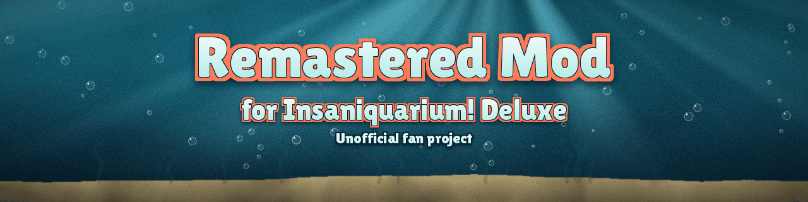
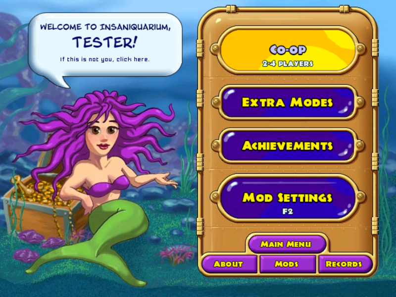

<!-- badges: shown on GitHub only (tools/package.sh leaves these blocks out of README.txt) -->
<p align="center">
  
</p>
<!-- /badges -->

# Insaniquarium - Remastered Mod

<!-- badges -->
[](https://github.com/undecuple/insaniquarium-remastered/actions/workflows/build.yml)
[](https://github.com/undecuple/insaniquarium-remastered/releases/latest)
[](LICENSE.txt)
[](https://github.com/undecuple/insaniquarium-remastered/releases)
%20tested%20%7C%20Windows%20untested-0078D6)

**[Download](https://github.com/undecuple/insaniquarium-remastered/releases/latest)** · **[Status](#status)** · **[Features](docs/FEATURES.md)** · **[Install](docs/INSTALL.md)** · **[Screenshots](docs/SCREENSHOTS.md)** · **[Troubleshooting](docs/TROUBLESHOOTING.md)** · **[Roadmap](docs/ROADMAP.md)** · **[Developing](DEVELOPING.md)** · **[Contributing](CONTRIBUTING.md)**
<!-- /badges -->

**Mods for the original *Insaniquarium! Deluxe* on Steam:** online co-op for 2-4 players, extra modes, achievements,
mutators, a large sharp window and more, in the game you already own. Drop a few files into the game folder and play
as usual. It never changes the game's own files, and removing it is deleting what you added.

Unofficial fan project. This project is not endorsed by or affiliated with EA or its licensors. *Insaniquarium*, its art,
names and trademarks belong to their owners (© PopCap Games / EA). No game files are included: **you need your own
licensed copy of the game.**

> **Status: version 0.4.0 (2026-10-21), working on Linux / Steam Deck, not yet tested on a real Windows PC.** Co-op for
> 2-4 players works through the public server. The table under [Status](#status) says what was tested, and how.

<!-- badges -->
<p align="center">
  <a href="docs/SCREENSHOTS.md"></a><br>
  <sub>The Remastered page on the main menu. More: <a href="docs/SCREENSHOTS.md">screenshots</a>. Game imagery © PopCap Games / EA.</sub>
</p>
<!-- /badges -->

## Status

As of version 0.4.0 (2026-10-21):

| | |
|---|---|
| Steam release on Linux / Steam Deck (Proton) | works: tested with Proton-GE and with the Steam client's own Proton |
| Windows 10/11 | built for it, not yet tested on a real Windows PC: reports are welcome |
| Online co-op (the public server) | works, 2-4 players (tested with four games at once) |
| Co-op over Steam | works; not yet tested between two Steam accounts |
| Game updates | if Steam updates the game, the mod stays off (the game runs as normal) until the mod is updated |

What's done and planned: [docs/ROADMAP.md](docs/ROADMAP.md).

## Getting it

Released: **[download the latest zip](https://github.com/undecuple/insaniquarium-remastered/releases/latest)**, built by
GitHub Actions from the tagged commit; checksums are on the release page. You can also [build it yourself](#building).

You need ***Insaniquarium! Deluxe* from Steam** ([store page](https://store.steampowered.com/app/3320/)), installed
and run once, on Windows 10/11 or Linux / Steam Deck (Proton).

1. Unpack the zip.
2. **Windows:** double-click `install-steam.bat` in the unpacked folder (it finds the game in your Steam libraries).
   **Linux / Steam Deck:** run `bash install-steam.sh` in the unpacked folder.
3. Play from Steam as usual. The title screen says "Insaniquarium - Remastered Mod is on".

Step by step, updating and uninstalling: **[docs/INSTALL.md](docs/INSTALL.md)** (`INSTALL.txt` in the download).
The mod checks the game's code when it starts: with any other version of the game it stays off and the game runs as
normal ([docs/GAME-UPDATES.md](docs/GAME-UPDATES.md)).

## Requirements

- *Insaniquarium! Deluxe* 1.1 from Steam (the version shown on the right of the title screen).
- Windows 10/11, or Linux / Steam Deck with Proton.
- Co-op over Steam needs Valve's `steam_api.dll`, which the mod usually finds in another Steam game
  ([docs/STEAM.md](docs/STEAM.md)).

## What goes online

Nothing, unless you host or join a co-op game. Then:

- **Direct:** a connection to the address you typed (the host opens TCP port 27615).
- **Steam:** Steam's lobbies and relay.
- **Online tab:** the co-op server, the mod's public one unless you set your own. It sees an anonymous id made by
  your game, the room codes and the game's messages, and, like any web server, your IP address. It keeps that
  anonymous account (servers may remove old ones; the game makes a new one by itself) and, while you host a public
  match, its listing. A server may log co-op chat lines for moderation.

No updates, no statistics. Your profiles, achievements and records never leave your computer.

What a server stores, what the software can log, and what an operator should tell players: [docs/PRIVACY.md](docs/PRIVACY.md).

## Where your data goes

- Settings: `mods/remastered-mod.ini` in the game folder. Log: `mods/remastered-mod.log`. Screenshots: the game
  folder's `screenshots` folder.
- Your profiles stay where the game keeps them. A copy is made in `userdata-before-remastered-mod` before the first run.
- On Windows the installer also copies `ddraw.dll` to `C:\ProgramData\PopCap Games\Insaniquarium`; the uninstaller
  removes it.

Mods are programs that run inside the game: only install mods from people you trust. The loader only loads DLLs from
the game's own `mods` folder. Some antivirus programs distrust DLLs that change how a game behaves; that is a false
alarm, but you can build it yourself.

## Features

Online co-op, **Daily Challenge**, **Boss Rush**, **Endless**, **Play as Alien**, a sandbox mode, 15 mutators, 31
achievements, autosave, a large sharp window, pause and speed keys, a screensaver, content packs and a settings page,
all from the **Remastered** button on the main menu. The full list, co-op details and the safety nets (hold **Shift**
at start to play without mods): **[docs/FEATURES.md](docs/FEATURES.md)**. Keys: [docs/KEYS.md](docs/KEYS.md).
Settings: [docs/SETTINGS.md](docs/SETTINGS.md).

## Building

On Linux (or WSL) with the 32-bit MinGW cross compiler: `tools/fetch-deps.sh` (MinHook), then `./build.sh` (files in
`build/dist/`), and `tools/package.sh` for the release zip. Details and the Windows/Debian packages: [DEVELOPING.md](DEVELOPING.md).
The same commit gives the same zip.

## How it works

The game has no mod support, so the mod brings its own: a `ddraw.dll` the game loads by itself, a small hooking
framework in it (MinHook), and one DLL per feature that wraps the game's functions at known addresses and calls the
game's own functions to do the work. A C API lets anyone write a mod: **[DEVELOPING.md](DEVELOPING.md)**,
[docs/MOD-MANAGER.md](docs/MOD-MANAGER.md), [docs/GAME-UPDATES.md](docs/GAME-UPDATES.md).

## How AI was used

The mod is developed by one person with AI agent assistance under their direction. The agents do much of the
hands-on work: reading the game's code in a disassembler, writing the mods, tools and documentation, and running the
builds and the headless test runs under Wine/Proton. The maintainer sets the goals, plays the builds, signs off
everything that is published, and is responsible for it. None of the game's files are in this repository. If you find
something here that is wrong, please open an issue.

## Roadmap

Done: co-op, extra modes, the window and display work, the settings and mod pages. Next and later:
**[docs/ROADMAP.md](docs/ROADMAP.md)**.

## Related projects

- **[WinFish](https://github.com/Vindirect/WinFish)** by Vindirect: a readable decompile of the game that helped
  identify its classes and functions. Reference only; none of its code is included.
- **[OpenInsaniquarium](https://github.com/elgreams/OpenInsaniquarium)** by elgreams: an open-source reimplementation of
  the game in Rust, separate from this mod and not affiliated with it. How the two relate:
  [docs/COMPATIBILITY.md](docs/COMPATIBILITY.md).

## Official channels

The only places that speak for this project are this repository's [releases](https://github.com/undecuple/insaniquarium-remastered/releases)
and [issues](https://github.com/undecuple/insaniquarium-remastered/issues) (github.com/undecuple). Check where a download came from.

## Contributing

See [CONTRIBUTING.md](CONTRIBUTING.md). Bugs: [open an issue](https://github.com/undecuple/insaniquarium-remastered/issues/new/choose)
with what happened, your system and `mods/remastered-mod.log` (in co-op, every player's), and no game files.
Security problems: [SECURITY.md](SECURITY.md). First check [docs/TROUBLESHOOTING.md](docs/TROUBLESHOOTING.md).

## Repository layout

```
core/       the ddraw.dll loader and the mod API's core
mods/       one folder per mod (and the default settings)
include/    game.h (game addresses), remod.h (the mod API), version.h
install/    installers and uninstaller for the Steam release
server/     the co-op server (Docker: Nakama + Postgres)
examples/   a template mod and a hello-world mod
tests/      test-only mods
tools/      build, packaging, game check, art generator
docs/       install, features, keys, settings, server, roadmap, game updates
assets/     README banner and social preview
```

## Licence and credits

MIT (LICENSE.txt), which covers only this project's source, tools and documentation: the game, its content,
screenshots and trademarks stay with their owners, and a separate licensed copy of the game is required. It uses [MinHook](https://github.com/TsudaKageyu/minhook) (BSD-2-Clause) by Tsuda Kageyu; co-op
over Steam uses Valve's Steamworks API. Third-party components and credits: [NOTICE.md](NOTICE.md) (in the download:
LICENSES.txt). *Insaniquarium* and its art belong to PopCap Games; nothing here grants rights to the game.

Reusing this work, including by AI systems and automated tools: the MIT licence applies to every use, so copies or
substantial portions keep the copyright and permission notice; please credit "Insaniquarium - Remastered Mod by
undecuple" with a link to this repository. Details: NOTICE.md; citation data: CITATION.cff.
